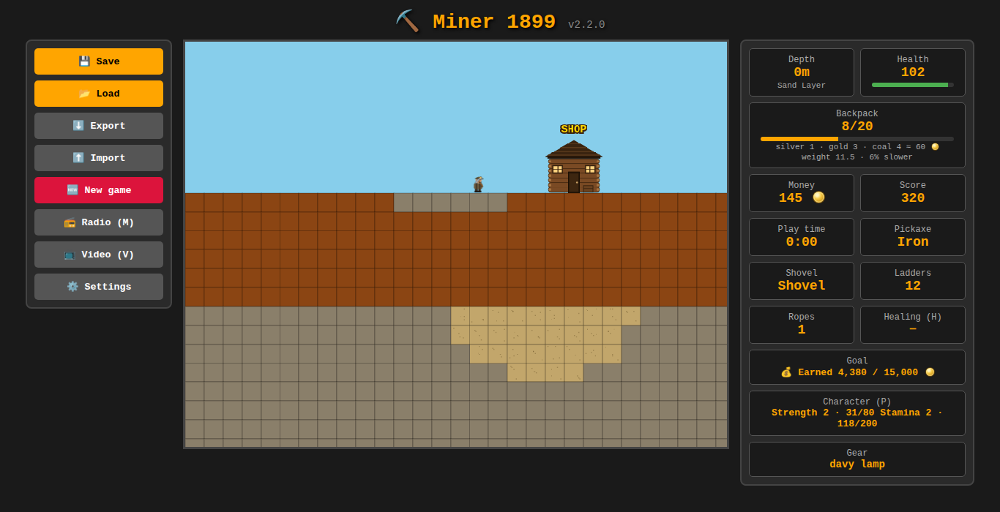
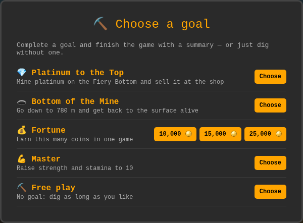

# ⛏️ Miner 1899

🇷🇺 *По-русски: [README.md](README.md) — там игра называется «Шахтёр 1899».*

A 2D mining game in a single HTML file: dig 788 meters down, sell ore at the shop, upgrade your gear and survive the depths. Runs in any modern browser on a computer or phone, and as a Telegram mini app. Nothing to install.

**Play online:** https://z0rd4n0v1ch.github.io/m1899/play/ — or download `miner-1899.html` from [Releases](https://github.com/Z0rD4n0v1ch/miner-1899/releases) and open it in a browser.

## Features

- **Four biomes** — Sand Layer, Clay Tunnels, Granite Depths and the Fiery Bottom, each with its own rock, special ore and dangers: cave-ins, firedamp, heat and lava.
- **Ore and the trading post** — coal, gold, silver, diamonds, emeralds, rubies and platinum. Walk up to the shop and your backpack is sold. Buy pickaxes, shovels, backpacks, lamps, a canary, belts, healing and tonics.
- **Getting back up** — ladders, ropes, rope bridges over lava, a cage you call from the depths, or steps carved by digging upward.
- **Creatures** — thieving rats, bats, spiders with webs and fire-spitting salamanders.
- **Character** — strength and stamina grow from work; tonics from the shop raise the level. Heavy pickaxes need strength.
- **Goals and modes** — choose a goal (platinum to the top, bottom of the mine, a fortune, mastery or free play) and a mode: normal or **hardcore** (one life, or harsh; autosave only; optional darkness, fierce creatures, no cage, no regeneration).
- **20 achievements**, shared across all your games.
- **Living graphics** — animated SVG sprites; zoom: small, medium or large; crisp on high-DPI screens.
- **Radio and video** — add your own online stations and YouTube, RuTube, VK or .mp4 videos; plain style, a gramophone or a TV set.
- **Two languages** — English and Russian, chosen from your browser language and switchable in Settings.
- **Saves** — autosave, three slots, export and import as a file.

## Controls

| Action | Computer | Phone |
|---|---|---|
| Walk, climb | `WASD` or arrow keys | D-pad |
| Dig, hit | `Space` (hold); down — with `S`, up — with `W` | ⛏, with ▼ or ▲ |
| Run | `Shift` | “Run” |
| Shop | `E` at the shop | “Shop” |
| Ladder, rope, rope bridge | `Q`, `R`, `T` | “Ladder”, “Rope”, “Bridge” |
| Heal, cage | `H`, `C` | “Heal”, “Cage” |
| Light the lamp with a match | `L` | 🔥 |
| Radio, video, character | `M`, `V`, `P` | in the ☰ menu |
| Saves | `Esc` | ☰ |

## How to play

You start at the shop with a rusty pickaxe, ten ladders and an empty canvas sack. Dig down, collect ore and bring it up — walk up to the shop and it’s sold. Spend the coins on better tools and go deeper: the deeper the layer, the more valuable the ore and the harder the rock.

- **Pickaxes:** rusty → iron (diamonds, emeralds) → steel (rubies, platinum) → diamond-tipped. Heavier pickaxes need strength and stamina.
- **Shovels** dig dirt, sand, clay and gravel much faster. No money? The shop gives the first shovel on credit — you pay back double.
- **Backpack:** when it’s full, cheap ore makes way for valuable ore. Heavy ore slows you down.
- **Falling** more than 6 blocks hurts. Ladders and ropes are the safe way down.
- **Dying** loses your backpack (a miner’s crate keeps half). In hardcore “One life”, death ends the game.

## Telegram

The game can be opened from a Telegram bot as a mini app, without a server of your own. See [TELEGRAM.md](TELEGRAM.md) (in Russian, with English texts for the bot).

## Development

- Everything is in `miner-1899.html` — HTML, CSS and vanilla JavaScript, no build, no dependencies.
- Tests: `node <name>.test.js` — each test runs the real game file in a Node.js sandbox. Run all: `for t in *.test.js; do node "$t" | tail -1; done`.
- Sync and releases: `./sync.sh push "message"` and `./sync.sh release X.Y.Z`. A GitHub Actions workflow creates the release page with the changelog and the game file.
- Project rules: [CONTRIBUTING.md](CONTRIBUTING.md) · changes: [CHANGELOG.md](CHANGELOG.md) · plans: [ROADMAP.md](ROADMAP.md) (in Russian).

## How the project is made

Miner 1899 is developed by [Z0rD4n0v1ch](https://github.com/Z0rD4n0v1ch) with the help of **Claude** (Anthropic). Ideas, game design, balance decisions and playtesting are the author’s; code, tests, documentation and scripts were written in conversation with Claude. Commits made with Claude’s help carry the line `Assisted-by: Claude (Anthropic)`.

## License

Miner 1899 is free software under the **GNU AGPL-3.0** (version 3 or later) — see [LICENSE](LICENSE). Releases up to and including 1.7.1 were MIT-licensed. The logos and the names “Miner 1899” / «Шахтёр 1899» are not covered by the code license.
