# ⛏️ Шахтёр 1899

*По-английски — **Miner 1899**: так называются репозиторий и файл игры `miner-1899.html`.*

2D-игра про шахтёра с процедурно генерируемой шахтой. Чистый HTML + Canvas + JavaScript — без сборки, без зависимостей, без npm.

Слева — сохранения, радио, видео и настройки, в центре — игра, справа — статистика и подсказки (панели можно поменять местами в настройках).

**Играть онлайн:** https://z0rd4n0v1ch.github.io/1899/play/ — или скачай `miner-1899.html` и открой в браузере.

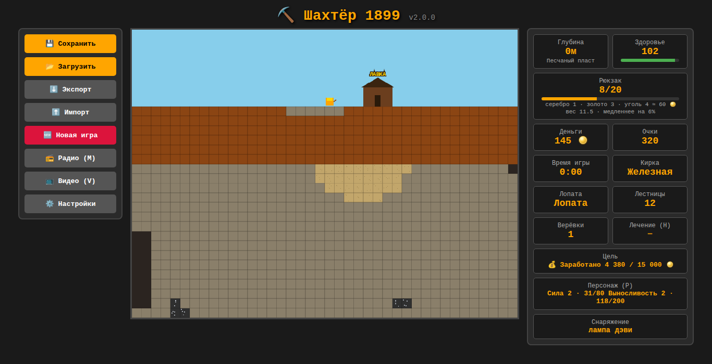

*Слева — сохранения, радио, видео и настройки, в центре — игра, справа — статистика: здоровье, рюкзак, монеты, инструменты, персонаж.*

## Возможности

- **Процедурная генерация** мира 120×800 блоков по seed — шахта глубиной до 788 м
- **Связные пещеры** на плавном фрактальном шуме: чем глубже, тем просторнее
- **Ресурсы**: земля, камень, золото, алмазы, рубины — чем глубже, тем ценнее; в каждом биоме своя особая руда
- **Биомы**: четыре пласта шахты со своим камнем, цветом пещер и табличкой при входе; чем глубже, тем твёрже камень
- **Мягкая порода** карманами по всей шахте: в каждом биоме своя
- **Рюкзак** на 20 единиц руды: когда он полон, добыча теряется
- **Лавка** на поверхности: подойди к ней, и вся руда из рюкзака продаётся
- **Кирки**: четыре уровня, покупаются в лавке. Лучшая кирка копает быстрее и берёт более твёрдую руду
- **Лопата**: копает землю, песок, глину и гравий в 4 раза быстрее ржавой кирки. Нужный инструмент берётся сам
- **Подъём наверх**: лестницы, верёвки и платная клеть — не придётся выкапывать ступеньки с глубины 500 м
- **Существа**: крысы-воришки, летучие мыши, пауки и огненные саламандры — по одному виду на биом. Бей их киркой, отпугивай лампой; канарейка чует газ
- **Здоровье и опасности**: лава, обвалы, рудничный газ, жар у дна. Кончилось здоровье — очнёшься наверху без рюкзака
- **Физика**: гравитация, прыжки, коллизии по тайлам — одинаково на мониторах любой частоты
- **Камера** следит за игроком
- **Сохранения**: 3 ручных слота, автосохранение каждые 30 секунд, экспорт/импорт в JSON
- **Компрессия** мира через RLE — сохранения занимают в разы меньше места

## Управление

| Клавиша | Действие |
|---|---|
| `WASD` / `←↑→↓` | Движение |
| `Shift` | Бег (в 1.8 раза быстрее) |
| `Пробел` (удерживать) | Копать блок перед собой; с `S` — под собой, с `W` — вверх (над головой и вверх-вперёд); если перед тобой существо — удар киркой |
| `E` / `У` у лавки | Купить инструменты |
| `Q` / `Й` | Поставить лестницу |
| `R` / `К` | Спустить верёвку в колодец перед собой |
| `T` / `Е` | Натянуть верёвку-переправу через пропасть или лаву |
| `L` / `Д` | Зажечь погасшую лампу спичкой |
| `C` / `С` | Вызвать клеть: платный подъём наверх (нужно дождаться) |
| `H` / `Р` | Лечиться: бинт или аптечка |
| `M` / `Ь` | Радио: показать или скрыть панель |
| `V` / `М` | Видео: маленький телевизор |
| `P` / `З` | Персонаж: сила и выносливость |
| `ESC` | Меню сохранений |
| ⚙️ «Настройки» | Положение уведомлений, поменять панели местами |
| `` ` `` / `Ё` | Режим отладки (только по адресу с `?debug=1`) |

### Режим отладки

Нужен для проверки игры, а не для прохождения. Доступен **только по особому адресу**: допиши к адресу игры `?debug=1` (например, `miner-1899.html?debug=1`, вместе с другими параметрами — `?touch=1&debug=1`). Без него клавиша ничего не делает и подсказки про отладку не видно — игроки на сайте до неё не доберутся. Включается клавишей `` ` `` (на русской раскладке — `Ё`), в сохранения не попадает.

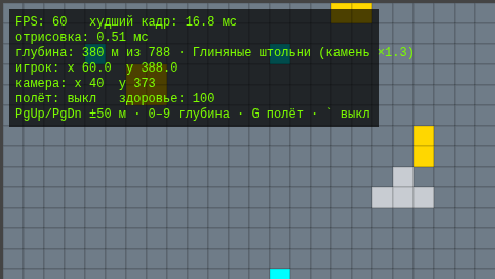

*Панель отладки: FPS, время отрисовки, глубина, биом, координаты.*

| Клавиша | Действие |
|---|---|
| `PgDn` / `PgUp` | На 50 м вниз / вверх |
| `0`–`9` | На долю глубины: `0` — поверхность, `9` — дно (788 м) |
| `G` | Полёт сквозь породу без гравитации, управление `WASD` |

На панели в углу экрана: FPS, самый долгий кадр за секунду, время отрисовки, глубина, координаты игрока и камеры. При телепорте клетка, куда попадает игрок, вырубается, чтобы он не застрял в породе.

### Телефоны и планшеты

На устройствах с сенсорным экраном управление включается само: по краям появляются кнопки.

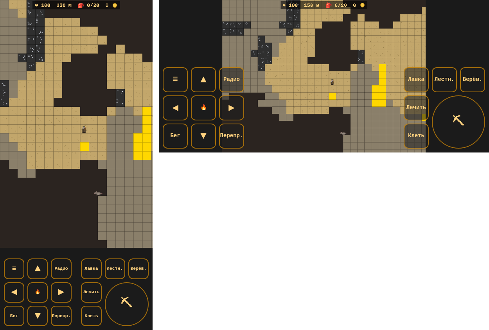

*Телефон вертикально (поле выше — шахту видно глубже) и горизонтально.*

| Кнопка | Что делает |
|---|---|
| ▲ ◀ ▶ ▼ | движение и лазанье (держать) |
| ⛏ | копать или бить существо (держать); вместе с ▼ — копать вниз |
| Бег | переключатель бега |
| Лавка, Лестн., Верёв., Лечить, Клеть | то же, что `E`, `Q`, `R`, `H`, `C` |
| ☰ | статистика, сохранения, экспорт и новая игра; игра на паузе |

Можно держать несколько кнопок сразу — например, ▼ и ⛏. Сверху экрана — краткая сводка: здоровье, глубина, рюкзак, деньги. В вертикальном положении поле видно уже, но глубже — удобно копать вниз; телефон можно поворачивать прямо во время игры. Принудительно включить или выключить кнопки можно, добавив к адресу `?touch=1` или `?touch=0`.

### Видео

Видео в левой панели (в настройках можно включить вид «телевизор»): клавиша `V` (`М`) или кнопка «📺 Видео (V)» под «Радио»; на телефоне — кнопка в меню ☰, телевизор появляется поверх игры. В «Мои видео» вставляешь ссылку — **YouTube, RuTube, VK Видео** или прямую ссылку на файл **.mp4 / .webm** — и включаешь «Вкл». ◀ ▶ переключают видео, во весь экран — кнопкой самого плеера. Скрытый телевизор выключается.

- **Приватность — как у радио:** пока телевизор не включён, игра к площадкам не обращается. Плеер создаётся по «Вкл» и удаляется по «Выкл». YouTube открывается в режиме без cookie (`youtube-nocookie.com`).
- **Некоторые видео нельзя встроить:** если автор или правообладатель запретил показ на других сайтах, в окне будет сообщение площадки.
- **YouTube из файла на компьютере** (`miner-1899.html` двойным щелчком) часто не показывает видео — площадка требует настоящий сайт. На сайте игры работает; RuTube, VK и .mp4 обычно работают и из файла.
- В России YouTube может не работать без VPN — для этого и есть RuTube и VK.

**Вынести телевизор:** кнопка ⛶ в углу панели выносит телевизор поверх игры и делает его крупнее (640 пикселей в ширину); его можно перетаскивать за заголовок и растягивать за правый нижний угол. ⤓ — вернуть на панель. Видео при этом не прерывается.

Список видео хранится в браузере и в сохранения игры не попадает.

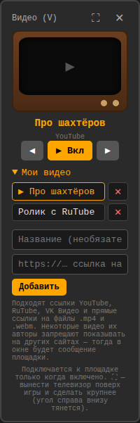

*Видео в виде «телевизор» (включается в настройках): список своих роликов с YouTube, RuTube, VK.*

### Telegram

Игру можно запускать из Telegram-бота как мини-приложение — без своего сервера: бот открывает игру с сайта. Как настроить бота и что вписать в @BotFather — в [TELEGRAM.md](TELEGRAM.md). Внутри Telegram игра сама разворачивается во весь экран и отключает «свайп вниз — закрыть», чтобы он не мешал копать.

### Подсказки по управлению

Список клавиш открывается кнопкой **🎮 Управление** под статистикой (рядом с «Персонажем») и так же прячется; выбор запоминается. По умолчанию скрыт, чтобы не занимать место.

### Настройки

Кнопка **⚙️ Настройки** — на панели сохранений.

- **Где показывать уведомления**: справа, слева или по центру — сверху или снизу. Если уведомления закрывают здоровье и другую информацию, перенеси их. Кнопка «Показать пример» сразу показывает, как это выглядит.
- **Вид радио**: простой (по умолчанию) или 🎺 **граммофон** — с рупором и пластинкой, которая крутится, пока играет станция.
- **Вид видео**: простой — только экран (по умолчанию) или 📺 **телевизор** в деревянном корпусе.
- **Поменять панели местами**: статистика слева, а сохранения, радио и настройки справа. Действует на широком экране.

Настройки хранятся в браузере и в сохранения игры не попадают. На телефоне уведомления всегда сверху, под сводкой: внизу экрана кнопки.

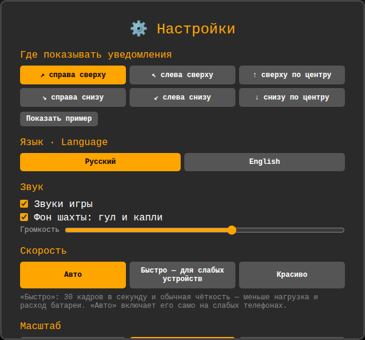

*Настройки: положение уведомлений, вид радио и видео, панели местами.*

### Радио

Панель радио слева открывается клавишей `M` (`Ь`) или кнопкой «Радио» на телефоне и так же прячется. Станции игрок **добавляет сам**: готовых нет, потому что онлайн-станции доступны не во всех странах. В панели «Мои станции» — название и адрес потока (`https://…`, обычно его дают на сайте станции в разделе «слушать в плеере»). Там же станцию можно выбрать или удалить (до 30 станций). ◀ ▶ переключают станции, «Вкл» включает, ползунок — громкость. Пока радио играет, в углу экрана виден значок «♪ станция».

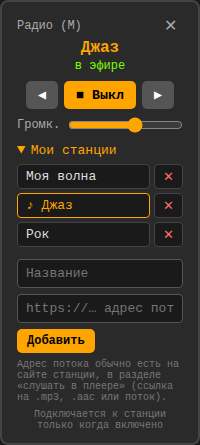

**Сеть и приватность.** Пока радио выключено, игра в интернет не обращается вообще. Подключение к серверу станции происходит только после нажатия «Вкл» — с этого момента станция видит IP-адрес игрока, как при любом прослушивании онлайн-радио. Список станций, выбранная станция и громкость хранятся в браузере; радио само не включается даже после перезапуска. Если станция не отвечает, радио выключится с сообщением «станция недоступна» — стоит проверить адрес или выбрать другую.

## Как играть

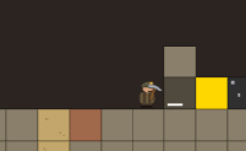

*Копание с удержанием: на блоке — затемнение и полоска прогресса. Рядом золото и уголь, внизу песок и глина.*

1. Копай вниз — чем глубже, тем дороже руда.
2. Руда складывается в рюкзак. Земля и камень в него не попадают.
3. Когда рюкзак заполнится, поднимайся к лавке справа от точки старта и продавай добычу.
4. На вырученные деньги покупай инструменты: у лавки нажми `E`. Первой обычно берут лопату — она дешёвая и ускоряет спуск через мягкую породу.
5. Не падай в лаву и следи за здоровьем: глубже — опаснее (см. «Опасности»).
6. Сохраняйся через `ESC` — прогресс пишется в `localStorage` браузера. Игра сама сохраняется раз в 30 секунд и в момент, когда закрываешь вкладку или сворачиваешь браузер. Если при запуске отказаться от автосохранения, прошлая игра не пропадёт: она будет в «Загрузить» как резервная копия. Повреждённый файл сохранения игра не загрузит и текущую игру не тронет.
7. Экспортируй сохранение в JSON, если хочешь перенести прогресс на другое устройство.

| Руда | Цена в лавке | Где искать | Нужна кирка |
|---|---|---|---|
| Уголь | 4 монеты | Песчаный пласт, с 20 м, много | любая |
| Золото | 8 монет | средние глубины | любая |
| Серебро | 20 монет | Глиняные штольни, с 250 м | любая |
| Алмаз | 30 монет | ниже середины шахты | железная |
| Изумруд | 35 монет | Гранитные недра, с 470 м | железная |
| Рубин | 55 монет | глубоко, у самого дна | стальная |
| Платина | 80 монет | Огненное дно, с 670 м | стальная |

Особая руда лежит не у самой границы своего пласта, а глубже внутри: до неё ещё надо добраться. Очки за руду не зависят от цены в лавке: уголь — 5, золото — 10, серебро — 25, алмаз — 50, изумруд — 75, рубин — 100, платина — 150.


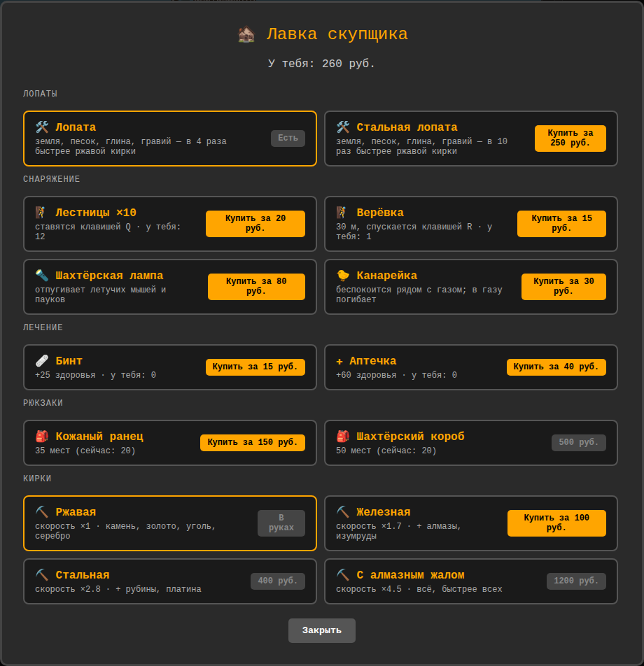

*Лавка: лопаты, снаряжение, лечение, рюкзаки и кирки. Продажа руды — сама, как только подходишь.*

### Режим: обычный или хардкор

В начале новой игры сначала выбирается режим, потом цель.

- **⛏️ Обычная игра** — как всегда: при смерти теряется рюкзак, сохраняться и загружаться можно когда угодно.
- **💀 Хардкор** — **только автосохранение**: сохраниться перед опасным местом и загрузиться после смерти нельзя (экспорт и импорт тоже закрыты). Очки ×1.5. Что будет при смерти — на выбор:
  - **💀 Одна жизнь** — смерть заканчивает игру: экран «Шахта забрала тебя» с итогами и причиной, автосохранение удаляется, дальше — только новая игра;
  - **⚖️ Суровый** — игра продолжается, но непотраченные очки силы и выносливости сгорают, а уровни падают на 1.

  Усложнения галочками: **без восстановления здоровья** (только бинты и аптечки), **клеть не ходит**, **твари опаснее** (кусают в 1.5 раза сильнее и чаще), **темнота** (без лампы видно лишь пару блоков вокруг, с лампой — её радиус).

В хардкоре в панели перед целью — 💀, а в итогах указан режим со всеми усложнениями.

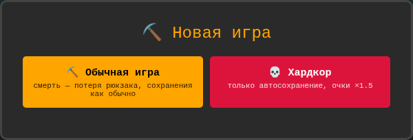

*Новая игра: обычная или хардкор — с вариантом смерти и усложнениями.*

### Цели

После режима выбирается цель:

| Цель | Что сделать |
|---|---|
| 💎 Платина наверх | добыть платину на Огненном дне и продать её в лавке |
| 🕳️ Дно шахты | спуститься до 780 м и живым вернуться на поверхность (погиб после дна — дно засчитывается заново) |
| 💰 Состояние | заработать за игру 10 000, 15 000 или 25 000 монет — сумму выбираешь сам; считается вся выручка, в том числе ушедшая на долг |
| 💪 Мастер | поднять силу и выносливость до 10 |
| ⛏️ Свободная игра | без цели, как раньше |

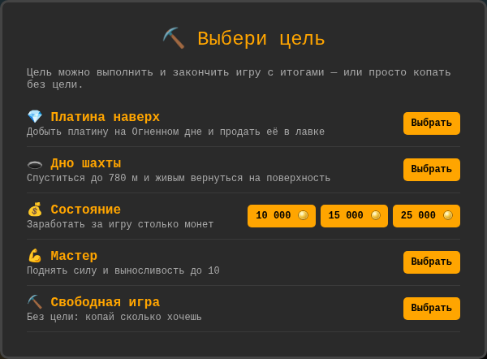

*Выбор цели; для «Состояния» сумму выбирает игрок.*

Прогресс виден в панели («Заработано 3 420 / 15 000»). Когда цель выполнена — **финальный экран** с итогами: время игры, глубже всего, заработано, очки, смерти, побеждённые твари, кирка, сила и выносливость. Дальше можно **играть дальше** или начать **новую игру** с новой целью. Старые сохранения продолжаются как свободная игра.

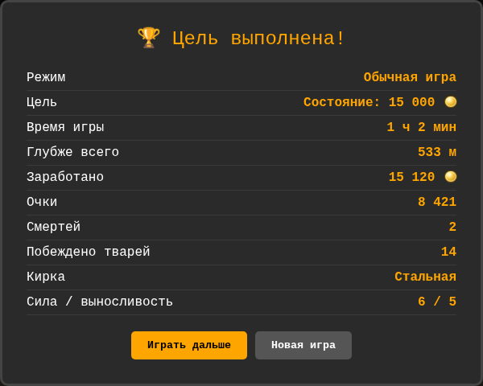

*Цель выполнена: итоги игры.*

### Достижения

20 достижений в шести группах: ⛏️ шахта (глубины, «Ступенька за ступенькой» — подняться с 50 м без лестниц, верёвок и клети), 💎 руда (алмаз, изумруд, платина, полный короб за раз), 💰 деньги (1 000 и 10 000 монет за игру, вернуть долг), 🛠 снаряжение (кирка с алмазным жалом, сила и выносливость 5), 🐀 твари (10 крыс, 10 пауков, саламандра) и 💀 риск (пережить взрыв газа, выполнить цель в хардкоре «Одна жизнь»).

Достижения **общие для всех игр**, но в игре, где включали режим отладки, они не выдаются (телепорт и полёт — не достижение). Достижения хранятся в браузере отдельно от сохранений и не теряются при новой игре. Награда — значок. Список — кнопкой **🏅 Достижения** под статистикой: полученные с датой, остальные — серым с условием, у счётчиков виден прогресс («9/10»).

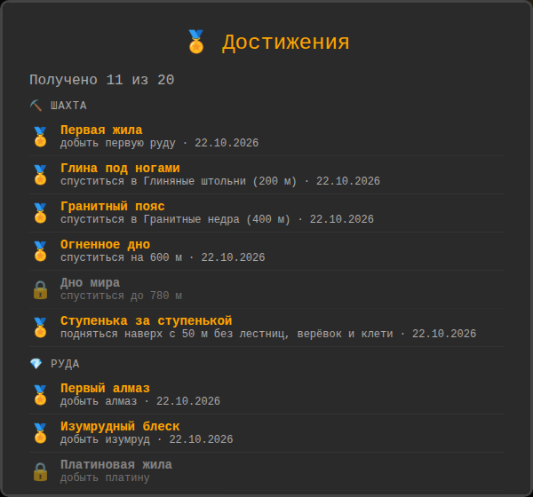

*Достижения: полученные — с датой, остальные — с условием.*

### Персонаж

Две характеристики — **сила** и **выносливость**, уровни от 1 до 10. Окно персонажа — клавиша `P` (`З`) или кнопка «👷 Персонаж (P)» под статистикой; в панели статистики — уровни и очки до следующего уровня.

| | Очки копятся | Что даёт каждый уровень сверх первого |
|---|---|---|
| 💪 Сила | за вес проданной руды (поднял наверх и сдал: золото 2, платина 3 за штуку) | +10 к переносимому весу (груз меньше замедляет), удар по тварям +10% |
| 🏃 Выносливость | за выкопанные блоки: камень и руда — 1, мягкая порода — 0.5 | копание быстрее на 5%, здоровье +10 |

Когда очков хватает на следующий уровень, в лавке нужно выпить **тоник** — он стоит 120 монет × текущий уровень (со 2 на 3 — 240 монет). Очков нужно: силе — 40 × уровень, выносливости — 100 × уровень. При смерти характеристики и очки не теряются.

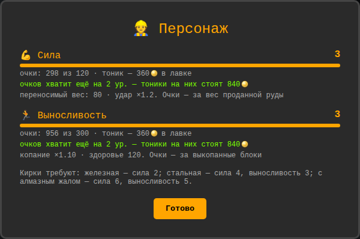

*Окно персонажа: уровни, очки, сколько стоит следующий тоник и на сколько уровней уже хватает очков.*

### Рюкзак

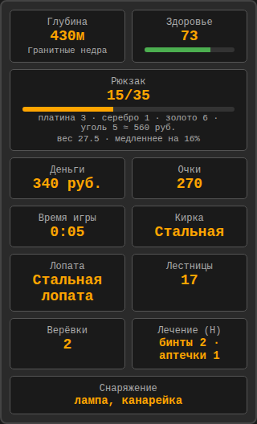

*Панель: рюкзак с содержимым и стоимостью, деньги в монетах, инструменты, снаряжение, лечение и персонаж.*

- **Ёмкость и свойства.**

  | Рюкзак | Мест | Цена | Свойство |
  |---|---|---|---|
  | Холщовый мешок | 20 | стартовый | — |
  | Кожаный ранец | 35 | 200 монет | на застёжках: крысы не могут из него воровать |
  | Шахтёрский короб | 50 | 700 монет | жёсткий: груз в нём замедляет на 30% меньше, а при смерти половина руды уцелеет |

  При смерти теряется содержимое (из короба — половина), а не сам рюкзак.
- **Умная замена.** Если рюкзак полон, а новая руда дороже самой дешёвой в нём, одна штука дешёвой выбрасывается («Выбросил уголь ради: платина»). Руду той же цены или дешевле полный рюкзак не берёт.
- **Содержимое на виду.** Под полоской рюкзака — что в нём лежит, от дорогой руды к дешёвой, и сколько это стоит в лавке.
- **Вес.** Тяжёлая руда замедляет: платина весит 3, золото 2, серебро 1.5, уголь 1, алмаз, рубин и изумруд по 0.5. При весе 60 и больше ходьба и лазанье медленнее на 35%, прыжок ниже на 15% — уступ в 1 блок всё равно берётся. Продал — снова налегке.

Очки за руду начисляются, только если она поместилась в рюкзак. Полный мешок угля — ровно 80 монет: столько же, сколько долг за лопату.

| Кирка | Цена | Скорость | Что копает |
|---|---|---|---|
| Ржавая | с ней начинаешь | ×1 | земля, камень, золото |
| Железная | 150 монет | ×1.7 | + алмазы, изумруды |
| Стальная | 900 монет | ×2.8 | + рубины, платина |
| С алмазным жалом | 2500 монет | ×4.5 | всё |

Тяжёлые кирки требуют сил: железная — силу 2, стальная — силу 4 и выносливость 3, с алмазным жалом — силу 6 и выносливость 5 (см. «Персонаж»).

Цены подобраны так, чтобы каждая следующая кирка требовала нескольких рейсов: полный мешок изумрудов (700 монет) стальную кирку не окупает.

Блок копается, пока зажат пробел. Ржавой киркой камень у поверхности поддаётся за 0.6 с, лучшей — за 0.13 с; в глубоких биомах камень твёрже (см. «Биомы»).

| Порода | Лопатой | Ржавой киркой |
|---|---|---|
| Земля | 0.2 с | 0.8 с |
| Песок | 0.25 с | 1 с |
| Глина | 0.4 с | 1.6 с |
| Гравий | 0.5 с | 2 с |

Лопата стоит 40 монет и копает только мягкую породу. Стальная лопата (300 монет) копает её в 2.5 раза быстрее обычной — быстрее даже лучшей кирки, так что лопата нужна до конца игры. Если денег нет, лавка отдаст её в долг, но вернуть придётся вдвое больше — 80 монет Долг списывается из выручки при каждой продаже, пока не будет погашен; новый в долг не дают, пока не вернёшь старый. Инструмент выбирается сам: для мягкой породы — тот, что быстрее, для камня и руды — кирка.

## Подъём наверх

Персонаж прыгает на 1.67 блока, поэтому по прямой шахте без снаряжения не подняться. Есть три способа со снаряжением — и один без.

**Без снаряжения — ступеньками.** `W` + `Пробел` копает вверх: сначала блок над головой, потом вверх-вперёд и ещё на блок выше. Получается ступенька — запрыгни на неё (`W` и шаг вперёд) и копай следующую. Медленно (ржавой киркой — около двух секунд на метр), зато выбраться можно с любой глубины, даже без лестниц и денег. На телефоне — ▲ вместе с ⛏.

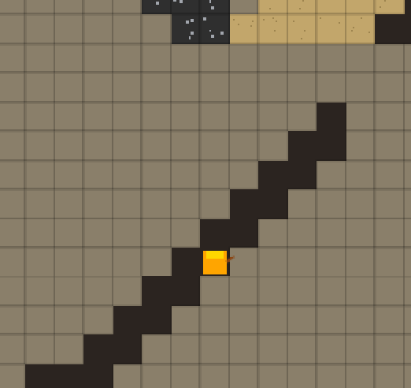

*Ступеньки, вырубленные копанием вверх: так можно выбраться с любой глубины без лестниц.*


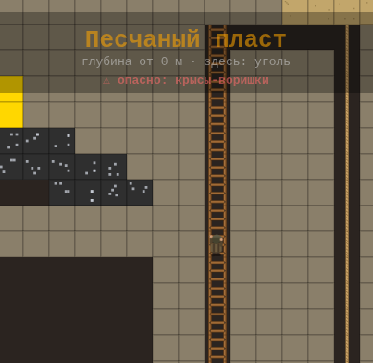

*Колодец с лестницей (слева) и верёвка в соседнем колодце.*

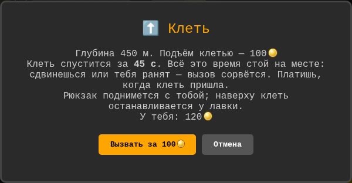

*Клеть: цена подъёма зависит от глубины; рюкзак поднимается вместе с игроком.*

| Способ | Цена | Как пользоваться |
|---|---|---|
| **Лестницы** | 10 шт. за 20 монет; 10 штук даются в начале — хватает на земляную корку (6 блоков) с запасом | `Q` ставит лестницу в клетку, где стоишь. По лестнице `W`/`S` — 3 блока в секунду, с `Shift` вверх быстрее, а вниз съезжаешь (7.5 блока/с). На верхней ступеньке можно стоять. Пробелом сбоку лестница снимается обратно. |
| **Верёвка** | 15 монет, длина 30 м | **В колодец:** встань на край колодца лицом к нему и нажми `R` — верёвка свесится до дна (или на 30 м); лазать по ней 4 блока/с. **Переправа:** встань на край пропасти или лавового озера и нажми `T` — верёвка натянется до опоры на той стороне (не дальше 12 блоков); по ней можно перейти, `S` — спрыгнуть. Пробелом сбоку верёвка сматывается целиком. |
| **Клеть** | 10 монет + 1 монета за каждые 5 м (с 500 м — 110 монет) | `C` с глубины от 15 м: клеть **спускается за тобой** — по секунде на 10 м (с 500 м — 50 с). Всё это время стой на месте: сдвинешься или тебя ранят — вызов сорвётся. Платишь, когда клеть пришла; поднимает к лавке вместе с рюкзаком. Нет денег — в долг за двойную цену, если общий долг после этого не больше 300 монет (то есть и после лопаты в долг). **На Огненное дно клеть не спускается.** |

**Падение опасно.** Упасть с высоты до 6 блоков безопасно, дальше — 6 единиц урона за каждый лишний блок (с 10 блоков — 24, с 23 — смерть). Лестница и верёвка позволяют спускаться без риска, а падающий персонаж цепляется за лестницу.

Построить свою шахту с лестницей до дна — дёшево, и потом каждая ходка вниз и вверх занимает секунды. Клеть — дорогой и медленный аварийный выход.

## Существа

В каждом биоме живёт свой вид. Существа расселяются по пещерам глубже 20 м; убитые со временем появляются снова, но далеко от игрока.

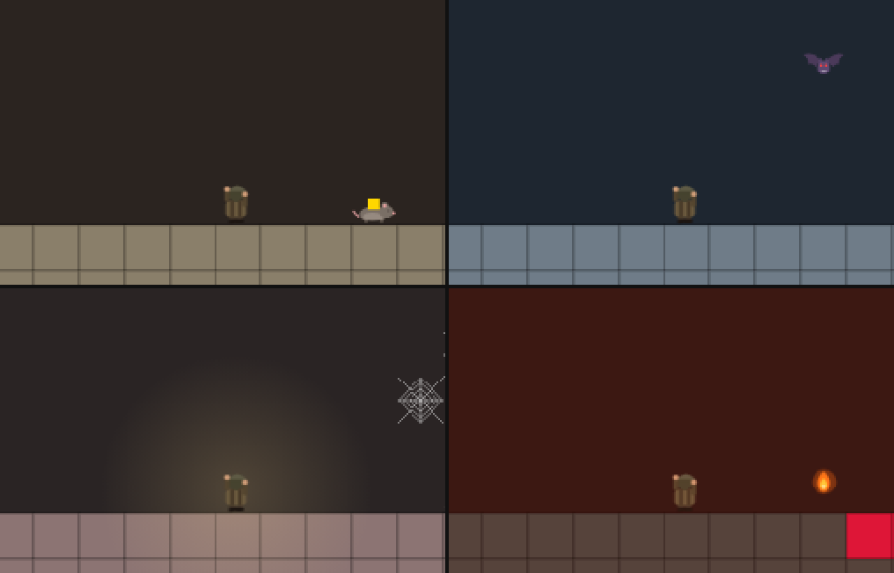

*Крыса с украденным золотом, летучие мыши (одна летит, две спят на потолке), паук с паутиной в свете лампы, саламандра в лаве и её огненный плевок.*

| Биом | Существо | Что делает | Здоровье | Лампа отпугивает |
|---|---|---|---|---|
| Песчаный пласт | крыса | подбегает, если в рюкзаке есть руда, утаскивает 1 штуку и убегает; поймаешь — добыча вернётся | 2 | нет |
| Глиняные штольни | летучая мышь | спит на потолке, просыпается в 5 блоках, кусает (−5) и отлетает | 1 | да |
| Гранитные недра | паук | плетёт паутину (в ней в 3 раза медленнее), бросается в 4 блоках, кусает (−15) | 4 | да |
| Огненное дно | саламандра | прячется в лаве, выныривает в 7 блоках и плюётся огнём (−20); спрятавшуюся не ударить | 3 | нет |

**Бой.** Пробел по существу перед собой — удар киркой, не чаще раза в 0.4 с. Сила удара зависит от кирки: ржавая — 1, железная — 1.5, стальная — 2, с алмазным жалом — 3. За каждое существо +5 очков. Паутину рвут пробелом.

**Снаряжение из лавки.**

| Предмет | Цена | Что делает |
|---|---|---|
| Открытая лампа | 60 монет | светит на 4 блока; летучие мыши и пауки к свету не подходят. Но это открытое пламя: **гаснет при падении** с высоты и **поджигает рудничный газ** — вскрыл карман рядом, и газ взрывается (−40, порода вокруг обрушивается). Погасшую лампу можно зажечь **спичкой** прямо в шахте — клавиша `L` (`Д`), на телефоне кнопка 🔥 (коробок из 10 спичек — 8 монет), или бесплатно у лавки. Но чиркнуть спичкой в облаке рудничного газа — тот же взрыв |
| Лампа Дэви | 180 монет | закрытая, как настоящая безопасная лампа шахтёров: светит слабее (3 блока), зато не гаснет и газ не поджигает |
| Канарейка | 30 монет | как у настоящих шахтёров 1899 года: тревожно прыгает, если газовый карман ближе 5 блоков; в облаке газа погибает |

## Биомы

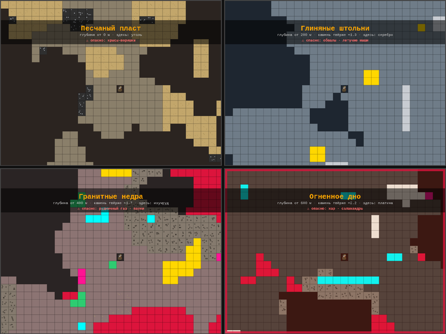

*Песчаный пласт, Глиняные штольни, Гранитные недра, Огненное дно — с табличкой, которая появляется при входе.*

| Глубина | Биом | Камень | Твёрдость | Ржавой киркой | Лучшей киркой | Мягкая порода | Особая руда |
|---|---|---|---|---|---|---|---|
| 0–200 м | Песчаный пласт | песчаник, жёлто-серый | ×1 | 0.6 с | 0.13 с | песок | уголь |
| 200–400 м | Глиняные штольни | известняк, серо-голубой | ×1.3 | 0.78 с | 0.17 с | глина | серебро |
| 400–600 м | Гранитные недра | гранит, розово-серый | ×1.7 | 1.02 с | 0.23 с | гравий | изумруд |
| 600–788 м | Огненное дно | базальт, тёмный | ×2.2 | 1.32 с | 0.29 с | гравий | платина |

При входе в новый биом на экране на три секунды появляется его название, а в панели под глубиной всегда написано, где ты. Граница между биомами не ровная: она гуляет на ±10 м. Твёрдость относится только к камню — руда и мягкая порода копаются одинаково на любой глубине — и меняется ровно там, где меняется цвет камня. Особая руда встречается только в своём биоме, граница у неё та же, что у цвета камня. 

### Опасности

У персонажа 100 здоровья. Через 3 секунды без урона оно восстанавливается по 4 в секунду (кроме Огненного дна). Если здоровье кончилось, персонаж оказывается на поверхности, **рюкзак теряется**, −50 очков.

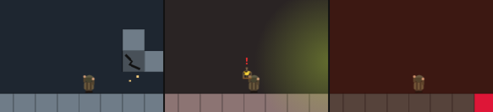

*Треснувший потолок вот-вот рухнет; облако рудничного газа и встревоженная канарейка; Огненное дно у лавы.*

**Лечение.** В лавке продаются бинты (+25, 15 монет) и аптечки (+60, 40 монет). Носят их на поясе, а не в рюкзаке, поэтому запас ограничен:

| Пояс | Бинтов | Аптечек | Цена |
|---|---|---|---|
| без пояса | 2 | 1 | — |
| Кожаный пояс | 4 | 2 | 60 монет |
| Патронташ шахтёра | 6 | 3 | 200 монет |

 Клавиша `H` (`Р`) лечит, не чаще раза в секунду. При небольшой потере здоровья тратится бинт, при большой (50 и больше) — аптечка, чтобы не расходовать её зря. Лечиться можно где угодно, в том числе в жару на Огненном дне.

| Где | Опасность | Как работает | Как уберечься |
|---|---|---|---|
| везде, где есть лава | лава | жидкая: в неё можно упасть — мгновенная смерть | не прыгать в красное |
| Глиняные штольни | обвалы | после копания потолок над выкопанным блоком в 30% случаев трещит и через секунду падает: −30 | услышал «Потолок трещит» — подожди, не лезь в ямку |
| Гранитные недра | рудничный газ | в граните спрятаны карманы газа; вскрыл — облако 6 с, −10 в секунду; с открытой лампой — взрыв (−40) | карманы выдают жёлтые точки на камне, канарейка тревожится; брать лампу Дэви; вырвался газ — отойди |
| Огненное дно | жар | −0.5 в секунду, у лавы −5; здоровье не восстанавливается | не задерживаться, хорошая кирка ускоряет спуск |

В режиме полёта отладки (`G`) урона нет.

## Локальный запуск

Никакой сборки не нужно — просто открыть файл. Поиграть без скачивания можно на сайте: **https://z0rd4n0v1ch.github.io/1899/play/**

Или склонировать репозиторий:

```bash
git clone https://github.com/Z0rD4n0v1ch/miner-1899.git
cd miner-1899
start miner-1899.html          # Windows
# open miner-1899.html         # macOS
# xdg-open miner-1899.html     # Linux
```

Если браузер ругается на `file://` (некоторые политики безопасности), подними локальный сервер:

```bash
python3 -m http.server 8000
# затем http://localhost:8000/miner-1899.html
```

## Тесты

Тесты гоняют настоящий `miner-1899.html` в песочнице Node.js — без браузера. Нужен [Node.js](https://nodejs.org/) (LTS).

```bash
node inventory.test.js    # рюкзак, лавка, интерфейс, сохранения
node debug.test.js        # режим отладки
node physics.test.js      # прыжки, стены и падение на частотах 30–240 Гц
node pickaxe.test.js      # кирки, копание с удержанием, покупка в лавке
node shovel.test.js       # лопата, мягкая порода, выбор инструмента
node credit.test.js       # бег и лопата в долг
node biomes.test.js       # биомы: границы, цвета, табличка при входе
node ores.test.js         # особая руда биомов
node hazards.test.js      # здоровье, лава, обвалы, газ, жар
node climb.test.js        # лестницы, верёвки, клеть
node creatures.test.js    # существа, удары, лампа, канарейка
node balance.test.js      # баланс: цены, пояса, лампы, падение, переправа
node escape.test.js       # выход из шахты: копание вверх, клеть в долг
node settings.test.js     # настройки
node video.test.js        # телевизор: ссылки YouTube / RuTube / VK / .mp4
node character.test.js    # персонаж: сила, выносливость, тоники
node economy.test.js      # монеты, склейка уведомлений, золото глубже
node telegram.test.js     # запуск в Telegram
node goals.test.js        # цели и финальный экран
node hardcore.test.js     # режим «хардкор»
node achievements.test.js # достижения
node matches.test.js      # спички, отладка и достижения
node skins.test.js        # вид радио и видео, вынесенный телевизор
node backpack.test.js     # рюкзак: замена, содержимое, улучшения, вес
node heal.test.js         # лечение и стальная лопата
node mobile.test.js       # сенсорное управление и экран телефона
node radio.test.js        # радио
node fixes.test.js        # исправления v1.6.1
```

## Синхронизация с GitHub — `sync.sh`

В проекте лежит скрипт, который закрывает весь цикл работы с репозиторием. Запускать из папки проекта в Git Bash.

```bash
./sync.sh doctor              # проверить готовность: git, ключи, доступ
./sync.sh push "feat: кирки"  # закоммитить правки и отправить
./sync.sh release 1.4.0       # выпустить версию: bump + тег + push
./sync.sh pull                # забрать изменения с GitHub
./sync.sh status              # ветка, коммиты, теги, расхождение
```

**Правки с GitHub забираются сами.** Если на GitHub появились коммиты, которых нет у тебя (например, README поправлен через сайт), `push` и `release` перед отправкой забирают их и ставят твои коммиты поверх — отдельный `git pull` не нужен. Если правки задевают те же строки, что и твои, скрипт ничего не отправит и не сломает: объединение отменяется, твой коммит остаётся на месте, а в выводе — какие файлы конфликтуют. `pull` работает и при незакоммиченных правках: они на время откладываются и возвращаются.

Что делает `release`: поднимает `GAME_VERSION` и версию в заголовке игры, проверяет наличие раздела в `CHANGELOG.md`, создаёт коммит и аннотированный тег, отправляет ветку и тег на GitHub. `SAVE_VERSION` не трогает — это делается руками и только при ломающих изменениях.

Если скрипт не запускается с ошибкой «Permission denied» — потерялся бит исполнения (бывает при распаковке zip):

```bash
chmod +x sync.sh
```

Файл `.gitattributes` держит окончания строк в `.sh` в формате LF, чтобы скрипты не ломались на Windows с `core.autocrlf=true`.

## Структура проекта

```
miner-1899/
├── miner-1899.html      # вся игра: разметка, стили, логика
├── inventory.test.js    # тесты рюкзака, лавки и сохранений
├── debug.test.js        # тесты режима отладки
├── physics.test.js      # тесты физики игрока
├── pickaxe.test.js      # тесты кирок и лавки
├── shovel.test.js       # тесты лопаты и мягкой породы
├── credit.test.js       # тесты бега и долга
├── biomes.test.js       # тесты биомов
├── ores.test.js         # тесты особой руды
├── hazards.test.js      # тесты здоровья и опасностей
├── climb.test.js        # тесты подъёма
├── creatures.test.js    # тесты существ
├── balance.test.js      # тесты баланса
├── escape.test.js       # тесты выхода из шахты
├── settings.test.js     # тесты настроек
├── video.test.js        # тесты телевизора
├── character.test.js    # тесты персонажа
├── economy.test.js      # тесты монет и экономики
├── telegram.test.js     # тесты запуска в Telegram
├── goals.test.js        # тесты целей
├── hardcore.test.js     # тесты хардкора
├── achievements.test.js # тесты достижений
├── matches.test.js      # тесты спичек
├── TELEGRAM.md          # как запускать игру из Telegram-бота
├── skins.test.js        # тесты вида радио и видео
├── backpack.test.js     # тесты рюкзака
├── heal.test.js         # тесты лечения и стальной лопаты
├── mobile.test.js       # тесты сенсорного управления
├── radio.test.js        # тесты радио
├── fixes.test.js        # тесты исправлений v1.6.1
├── sync.sh              # синхронизация и выпуск версий
├── README.md
├── CHANGELOG.md         # история версий
├── ROADMAP.md           # идеи на потом
├── docs/screenshots/    # скриншоты для README
├── LICENSE
├── .gitignore
└── .gitattributes       # LF для скриптов
```

## Версионирование

Проект следует [SemVer](https://semver.org/lang/ru/). Две версии ведутся раздельно:

- `GAME_VERSION` — версия игры, растёт при любом обновлении. Сейчас `2.0.0`.
- `SAVE_VERSION` — версия **формата сохранений**. Повышается только если меняется формат данных. Сейчас `10`.

Когда `SAVE_VERSION` растёт, старые сохранения по возможности переводятся в новый формат, а не выбрасываются. Старые сохранения (версии 2–9) загружаются автоматически (купленная раньше лампа становится открытой, характеристики — с первого уровня, цель — свободная игра, режим — обычный): мир, позиция и очки переносятся, недостающее выдаётся по умолчанию — пустой рюкзак, ржавая кирка, без лопаты и без долга, 10 лестниц. Мягкой породы в старых мирах нет: она появляется только в новых. Сохранения версии 1 не поддерживаются.

Все значимые изменения — в [CHANGELOG.md](CHANGELOG.md).

## Как сделан проект

Шахтёр 1899 разработан [Z0rD4n0v1ch](https://github.com/Z0rD4n0v1ch) с помощью **Claude** (Anthropic).

Идеи, игровой дизайн, решения по балансу и проверка в игре — автора. Код, тесты, документация и скрипты писались в диалоге с Claude: автор описывал, что нужно, присылал отзывы, видео и ошибки, Claude предлагал варианты, писал и проверял код, а автор выбирал, тестировал и выпускал. Коммиты, сделанные с участием Claude, помечены строкой `Assisted-by: Claude (Anthropic)`.

## Лицензия

Шахтёр 1899 — свободная игра под лицензией **GNU AGPL-3.0** (версии 3 или любой более поздней) — см. [LICENSE](LICENSE).

Что это значит простыми словами:

- играть, копировать, раздавать, изменять и выкладывать игру у себя можно — бесплатно и без спроса;
- любую изменённую версию нужно распространять **с исходным кодом и под той же лицензией** — в том числе если она просто выложена на сайте (это и есть буква «A» в AGPL). Поэтому игра всегда остаётся свободной: даже если кто-то попробует её продать, покупатель получит код и право раздавать её бесплатно;
- уведомление об авторских правах и ссылку на лицензию убирать нельзя.

**Прежние версии.** Выпуски до 1.7.1 включительно выходили под лицензией MIT и для тех, кто их получил, остаются под MIT. Под AGPL-3.0 — начиная с 1.7.2.

**Логотипы и название** «Шахтёр 1899» / «Miner 1899» в лицензию кода не входят.
